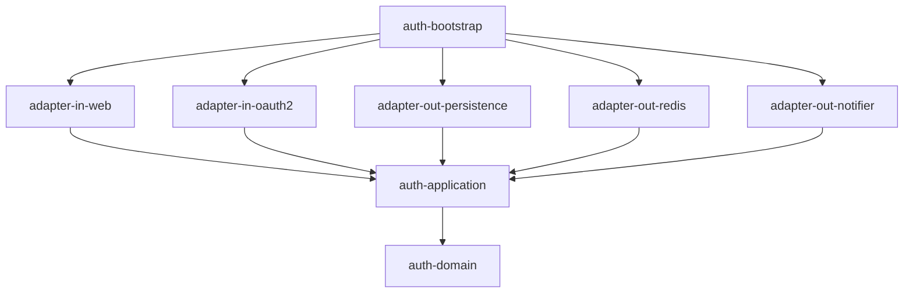

# mini-sso

[](https://github.com/kang30984/mini-sso/actions/workflows/ci.yml)

대규모 그룹사 임직원 포털을 가정한 **SSO 인증 서버**와, 여러 서비스가 의존하는 **공통 인증 SDK**를 축소 재현한 프로젝트입니다.

기능 구현보다 **"여러 서비스가 기대는 인증 기반을 어떻게 설계하는가"**에 초점을 둡니다. 모든 주요 결정은 [ADR](docs/adr/README.md)로 남깁니다.

## 핵심 목표

- OAuth2 Authorization Code + PKCE, OIDC 기반 SSO (서로 다른 오리진의 서비스 간 자동 로그인)
- Refresh Token Rotation과 재사용 탐지 시 토큰 계보 전체 폐기
- 무중단 서명키 로테이션, Back-Channel Logout
- 의존성 1줄과 설정 3줄로 동작하는 Spring Boot Starter SDK
- 헥사고날 아키텍처를 멀티모듈과 ArchUnit으로 강제
- k6 부하 테스트 결과를 수치로 기록

## 기술 스택

| 영역 | 사용 기술 |
|---|---|
| 언어 | Kotlin (인증 서버), Java 21 (SDK) |
| 프레임워크 | Spring Boot 3.5, Spring Security 6, Spring Authorization Server |
| 데이터 | MySQL 8.4, JPA, QueryDSL, Redis 7 |
| 빌드 | Gradle Kotlin DSL, Convention Plugin, Version Catalog |
| 테스트 | JUnit 5, Testcontainers, ArchUnit, WireMock, k6 |
| CI/CD | GitLab CI/CD (주), GitHub Actions (보조) |

## 아키텍처



| 모듈 | 책임 |
|---|---|
| `auth-domain` | 계정·세션·서명키 도메인 규칙 (프레임워크 의존 없음) |
| `auth-application` | 유스케이스와 포트 |
| `auth-adapter-in-web` | REST API, 로그인 페이지 |
| `auth-adapter-in-oauth2` | Spring Authorization Server 연동 |
| `auth-adapter-out-persistence` | JPA / QueryDSL |
| `auth-adapter-out-redis` | SSO 세션, 인가 상태, Rate Limit |
| `auth-adapter-out-notifier` | Back-Channel Logout 발송 |
| `auth-bootstrap` | 실행 진입점, 빈 조립, 아키텍처 테스트 |
| `auth-sdk-core` | Spring 의존 없는 JWT 검증 |
| `auth-sdk-spring-boot-starter` | AutoConfiguration 기반 SDK |

자세한 설계는 [docs/DESIGN.md](docs/DESIGN.md)를 참고하세요.

## 로컬 실행

요구 사항: JDK 21, Docker

```bash
docker compose up -d                                  # MySQL, Redis
./gradlew :auth-server:auth-bootstrap:bootRun         # http://localhost:9000/actuator/health
```

테스트

```bash
./gradlew test               # 단위 테스트 + ArchUnit
./gradlew integrationTest    # Testcontainers 통합 테스트 (Docker 필요)
```

## 로드맵

- [x] 1주차: 멀티모듈 골격, Convention Plugin, docker-compose, CI, 아키텍처 테스트
- [ ] 2주차: 계정 도메인, JPA/QueryDSL 어댑터, 계정 API
- [ ] 3주차: Spring Authorization Server 연동, Authorization Code + PKCE, OIDC
- [ ] 4주차: Redis SSO 세션, Refresh Token 회전·재사용 탐지, 로그아웃
- [ ] 5주차: SDK core·starter, 서명키 로테이션, 샘플 앱 2개
- [ ] 6주차: k6 부하 테스트와 성능 개선, 문서 정리

## 성능 측정

> 6주차에 측정 환경과 함께 p95 응답시간, TPS를 기록합니다.
