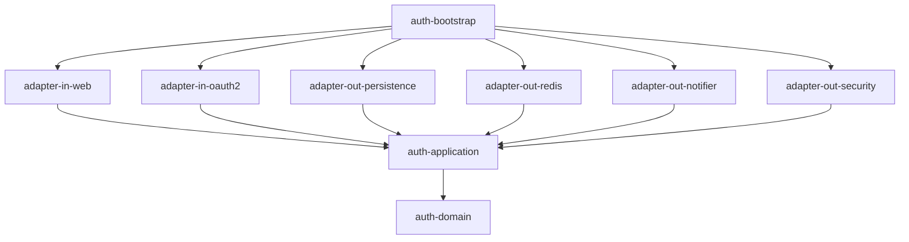

# mini-sso

[](https://github.com/kang30984/mini-sso/actions/workflows/ci.yml)

대규모 그룹사 임직원 포털을 가정한 **SSO 인증 서버**와, 여러 서비스가 의존하는 **공통 인증 SDK**를 축소 재현한 프로젝트입니다.

기능 구현보다 **"여러 서비스가 기대는 인증 기반을 어떻게 설계하는가"**에 초점을 둡니다. 모든 주요 결정은 [ADR](docs/adr/README.md)로 남깁니다.

**한눈에 보기**
- OAuth2 / OIDC 인가 서버 (Authorization Code + PKCE, SSO, RP-Initiated / Back-Channel Logout)
- 리프레시 토큰 재사용 탐지, 서명 키 무중단 교체, 로그인 시도 제한
- 서비스용 SDK: 의존성 1줄 + 설정 3줄로 토큰 검증 (샘플 앱 B는 보안 코드 0줄)
- 부하 테스트로 동시 로그인 버그를 찾아 수정하고, 토큰 갱신 처리량을 **12배** 개선 ([성능](#성능))
- 헥사고날 + Gradle 멀티모듈 13개, ArchUnit으로 의존 규칙 강제, ADR 12건, [트러블슈팅 기록](docs/troubleshooting.md) 8건

## 핵심 목표

- OAuth2 Authorization Code + PKCE, OIDC 기반 SSO (서로 다른 오리진의 서비스 간 자동 로그인)
- Refresh Token Rotation과 재사용 탐지 시 토큰 계보 전체 폐기
- 무중단 서명키 로테이션, Back-Channel Logout
- 의존성 1줄과 설정 3줄로 동작하는 Spring Boot Starter SDK
- 헥사고날 아키텍처를 멀티모듈과 ArchUnit으로 강제
- k6 부하 테스트 결과를 수치로 기록

## 기술 스택

| 영역 | 사용 기술 |
|---|---|
| 언어 | Kotlin (인증 서버), Java 21 (SDK) |
| 프레임워크 | Spring Boot 3.5, Spring Security 6, Spring Authorization Server |
| 데이터 | MySQL 8.4, JPA, QueryDSL, Redis 7 |
| 빌드 | Gradle Kotlin DSL, Convention Plugin, Version Catalog |
| 테스트 | JUnit 5, Testcontainers, ArchUnit, WireMock, k6 |
| CI/CD | GitLab CI/CD (주), GitHub Actions (보조) |

## 아키텍처



| 모듈 | 책임 |
|---|---|
| `auth-domain` | 계정·세션·서명키 도메인 규칙 (프레임워크 의존 없음) |
| `auth-application` | 유스케이스와 포트 |
| `auth-adapter-in-web` | REST API, 로그인 페이지 |
| `auth-adapter-in-oauth2` | Spring Authorization Server 연동 |
| `auth-adapter-out-persistence` | JPA / QueryDSL |
| `auth-adapter-out-redis` | SSO 세션, 인가 상태, Rate Limit |
| `auth-adapter-out-notifier` | Back-Channel Logout 발송 |
| `auth-adapter-out-security` | Argon2id 비밀번호 해시 |
| `auth-bootstrap` | 실행 진입점, 빈 조립, 아키텍처 테스트 |
| `auth-sdk-core` | Spring 의존 없는 JWT 검증 (JWKS 캐시·재조회·장애 허용) |
| `auth-sdk-spring-boot-starter` | AutoConfiguration 기반 SDK (`@CurrentUser`, `@RequiresScope`, ProblemDetail) |
| `samples/sample-app-a` | 로그인하는 웹 서비스 (Java, Spring Security OAuth2 Client) |
| `samples/sample-app-b` | SDK로 보호되는 API 서비스 (Kotlin) |

자세한 설계는 [docs/DESIGN.md](docs/DESIGN.md)를 참고하세요.

## 로컬 실행

요구 사항: JDK 21, Docker

```bash
docker compose up -d                                                          # MySQL, Redis
./gradlew :auth-server:auth-bootstrap:bootRun --args='--spring.profiles.active=local'   # 인증 서버 :9000
./gradlew :samples:sample-app-a:bootRun                                       # 샘플 앱 A :8081 (웹)
./gradlew :samples:sample-app-b:bootRun                                       # 샘플 앱 B :8082 (SDK로 보호되는 API)
```

인증 서버는 서명 키 암호화용 마스터 키(`MINISSO_KEY_ENCRYPTION_KEY`)가 없으면 기동하지 않습니다. `local` 프로필에는 데모용 키가 들어 있습니다.

`local` 프로필은 기동 시 최초 관리자(`admin` / `Local-Passw0rd!`)와 샘플 앱 클라이언트를 등록합니다. 로컬 데모용 값이며, 운영에서는 환경 변수로 주입합니다.

**SSO 로그인 데모**

1. 브라우저에서 http://127.0.0.1:8081 접속
2. 인증 서버(`localhost:9000`) 로그인 페이지로 이동 → `admin` / `Local-Passw0rd!` 입력
3. 샘플 앱으로 돌아와 ID 토큰의 클레임(계정 ID, 이름, 부서, 이메일) 확인
4. "내 토큰으로 샘플 앱 B API 호출하기" → B가 SDK로 토큰을 검증하고 계정 ID와 호출한 서비스(`sample-app-a`)를 응답
5. "로그아웃" 버튼 → 인증 서버의 SSO 세션까지 종료되어, 다시 접속하면 로그인 페이지가 나타남

인증 서버와 샘플 앱은 일부러 다른 호스트(`localhost` / `127.0.0.1`)로 띄워 쿠키를 공유하지 않는 상태에서 SSO가 동작함을 보여줍니다.

테스트

```bash
./gradlew test               # 단위 테스트 + ArchUnit
./gradlew integrationTest    # Testcontainers 통합 테스트 (Docker 필요)
```

## 로드맵

- [x] 1주차: 멀티모듈 골격, Convention Plugin, docker-compose, CI, 아키텍처 테스트
- [x] 2주차: 계정 도메인, JPA/QueryDSL 어댑터, 계정 API
- [x] 3주차: Spring Authorization Server 연동, Authorization Code + PKCE, OIDC
- [x] 4주차: Redis SSO 세션, Refresh Token 회전·재사용 탐지, 로그아웃
- [x] 5주차: SDK core·starter, 서명키 로테이션, 샘플 앱 2개
- [x] 6주차: 로그인 시도 제한, k6 부하 테스트, 동시 로그인 버그 수정, 토큰 갱신 처리량 12배 개선, 트러블슈팅 문서

## 구현 하이라이트

**계정 잠금 정책 (도메인 규칙)**
- 5회 연속 실패 시 30분 잠금. 잠긴 동안에는 비밀번호 비교 자체를 하지 않아 무차별 대입을 차단
- 잠금 시 실패 횟수를 초기화해, 잠금이 풀린 뒤 한 번의 실수로 바로 재잠금되지 않음
- 정책 값은 `minisso.account.*` 설정으로 조정

**계정 존재 여부 노출 방지**
- 존재하지 않는 계정에도 실제 Argon2 해시 비교를 수행해 응답 시간 차이를 줄임
- 실패 사유는 감사 이력에만 남기고, 사용자 메시지는 통일 (3주차 로그인 화면)

**실패도 커밋되는 로그인**
- 로그인 실패를 예외가 아닌 결과값으로 반환. 예외로 처리하면 트랜잭션 롤백으로 실패 횟수와 이력이 사라지기 때문

**영속성**
- 도메인 모델과 JPA 엔티티 분리, 스키마는 Flyway로 관리하고 Hibernate는 `validate`만 수행
- 로그인 이력 검색은 QueryDSL 동적 조건 + No-Offset 커서 페이징, 조회 기간 최대 31일 강제
- 동시 가입 시 유니크 제약 위반을 도메인 에러 코드로 변환, 계정 수정은 `@Version` 낙관적 락

**OAuth2 / OIDC (Spring Authorization Server)**
- 프레임워크 확장 지점(`RegisteredClientRepository`, `AuthenticationProvider`, `OAuth2TokenCustomizer`)을 애플리케이션 포트에 연결하는 어댑터로 구현. 클라이언트 저장 구조와 로그인 정책은 도메인이 소유
- 모든 클라이언트에 PKCE(S256) 필수, 사내 1st-party 클라이언트라 동의 화면 생략 ([ADR-010](docs/adr/010-first-party-clients-pkce.md))
- 리다이렉트 URI 등록 정책: 절대 URI만, 와일드카드·fragment·사용자 정보 금지, http는 로컬 주소만 허용
- 토큰의 `sub`는 변하지 않는 계정 ID. ID 토큰에는 화면 표시용 프로필, 액세스 토큰에는 인가용 `roles`만 담아 개인정보 노출을 최소화
- 로그인 실패 메시지는 "없는 계정 / 탈퇴 / 비밀번호 오류"를 구분하지 않음. 잠금·휴면만 사용자 조치가 필요해 구분
- IP당 로그인 시도 제한(분당 20회, Redis 고정 윈도). Argon2 비교 전에 검사해 차단된 요청이 CPU를 쓰지 않으며, 차단 건은 이력에 쓰지 않아 공격 중 DB 쓰기 증폭을 막음
- 관리자 API는 이 서버가 발급한 JWT의 `ADMIN` 권한으로 보호. 최초 관리자는 기동 설정으로만 생성
- 인가 코드 + PKCE 전체 흐름(인가 요청 → 로그인 → 코드 → 토큰 교환 → 클레임 검증)을 통합 테스트로 재현해 CI에서 매번 검증

**세션과 토큰 생명주기**
- 인가 상태(코드·토큰)와 로그인 세션을 Redis에 저장해 재시작·수평 확장에도 유지. 토큰 만료 시각을 그대로 TTL로 써서 정리 배치가 없음 ([ADR-004](docs/adr/004-authorization-state-in-redis.md))
- Redis 키에는 토큰 원문 대신 SHA-256 해시를 사용
- 리프레시 토큰 회전 + 재사용 탐지: 이미 회전된 토큰이 다시 오면 탈취로 보고 그 로그인에서 이어진 토큰 전체를 폐기 ([ADR-007](docs/adr/007-refresh-token-reuse-detection.md))
- 로그아웃(OIDC RP-Initiated Logout): 로그인 세션 종료 → 해당 SSO 세션(`sid`)으로 발급된 토큰 일괄 폐기 → 참여 서비스에 OIDC Back-Channel Logout Token 전송 (비동기, 3회 재시도)
- 토큰 폐기를 알림 전송보다 먼저 수행해, 알림이 실패한 서비스도 다음 토큰 갱신 시점에 로그아웃됨

**SDK (서비스 쪽 토큰 검증)**
- `auth-sdk-core`(순수 Java, Spring 의존 없음)와 `auth-sdk-spring-boot-starter`로 분리. 검증 로직은 core에만 두고 starter는 Spring 연결만 담당
- 서비스는 의존성 1줄과 설정 3줄로 토큰 검증, `@CurrentUser`, `@RequiresScope`, 표준 401/403 응답(ProblemDetail)을 얻음. 샘플 앱 B에는 보안 설정 코드가 한 줄도 없음
- JWKS 캐시, 모르는 kid 재조회(최소 간격으로 폭주 방지), 인증 서버 장애 시 캐시 키로 계속 검증 ([ADR-005](docs/adr/005-local-jwt-verification.md))
- 모든 빈은 `@ConditionalOnMissingBean`으로 서비스가 재정의 가능, `issuer-uri` 누락은 기동 시점에 실패
- SDK 사용 서비스에 `kotlin-stdlib`를 강요하지 않도록 Java로 작성 ([ADR-002](docs/adr/002-kotlin-server-java-sdk.md))

**서명 키 무중단 교체**
- 키를 DB에 AES-256-GCM으로 암호화해 저장 (마스터 키는 환경 변수, kid를 AAD로 묶어 암호문 바꿔치기 방지)
- 교체 시 새 키로 즉시 서명하고 이전 키는 1시간 동안 JWKS에 게시 → 이미 발급된 토큰도 계속 검증 ([ADR-008](docs/adr/008-signing-key-rotation.md))
- 실제 JWKS 엔드포인트를 SDK로 조회해 "교체 전 토큰 / 교체 후 토큰 모두 검증"을 통합 테스트로 확인

**API**
- 오류 응답은 RFC 9457 ProblemDetail + 자체 코드 ([에러 코드 목록](docs/error-codes.md))
- 비밀번호가 담긴 요청·커맨드 객체는 `toString`에서 마스킹

## API 예시

관리자 API는 `ADMIN` 권한이 담긴 액세스 토큰이 필요합니다.

```bash
# 계정 생성
curl -X POST localhost:9000/api/admin/v1/accounts \
  -H "Authorization: Bearer $ADMIN_TOKEN" -H 'Content-Type: application/json' -d '{
  "loginId": "kim.cs", "email": "kim.cs@example.com",
  "name": "김철수", "department": "보안팀", "initialPassword": "Sso-Passw0rd!"
}'

# 잠금 해제
curl -X POST localhost:9000/api/admin/v1/accounts/1/unlock -H "Authorization: Bearer $ADMIN_TOKEN"

# 로그인 이력 검색 (다음 페이지는 응답의 nextCursor를 cursor로 전달)
curl -H "Authorization: Bearer $ADMIN_TOKEN" \
  'localhost:9000/api/admin/v1/login-histories?from=2026-10-01T00:00:00Z&to=2026-10-31T00:00:00Z&outcome=FAILURE&size=20'

# 서명 키 교체 / 상태 조회
curl -X POST localhost:9000/api/admin/v1/signing-keys/rotate -H "Authorization: Bearer $ADMIN_TOKEN"
curl localhost:9000/api/admin/v1/signing-keys -H "Authorization: Bearer $ADMIN_TOKEN"

# OIDC Discovery, 공개키
curl localhost:9000/.well-known/openid-configuration
curl localhost:9000/oauth2/jwks
```

### SDK 적용 예 (샘플 앱 B)

```kotlin
// build.gradle.kts
implementation(project(":auth-sdk:auth-sdk-spring-boot-starter"))
```

```yaml
mini-sso:
  issuer-uri: http://localhost:9000
  audiences: [ sample-app-a ]
  public-paths: [ /api/public/** ]
```

```kotlin
@GetMapping("/me")
fun me(@CurrentUser user: AuthUser) = mapOf("accountId" to user.accountId())

@RequiresScope("profile")
@GetMapping("/team-reports")
fun teamReports(@CurrentUser user: AuthUser) = ...
```

## 성능

k6 시나리오 4개(로그인 전체 흐름, 토큰 갱신, SDK로 보호되는 API, 기준선)를 GitHub Actions에서 같은 환경으로 실행합니다. 실행 방법은 [load-test/README.md](load-test/README.md)를 참고하세요.

### 1차 측정에서 발견한 문제

GitHub Actions 러너 1대(MySQL, Redis, 인증 서버, 샘플 앱, k6를 모두 실행), 가상 사용자 20명 기준입니다.

| 시나리오 | 처리량 | 평균 지연 | 실패율 |
|---|---|---|---|
| 기준선 (JWKS) | 8,704 req/s | 5.6ms | 0% |
| 전체 로그인 흐름 | 19.2 회/s | 918ms | **26.5%** |
| 토큰 갱신 | 23.4 회/s | 823ms (갱신 요청) | 6.8% |
| SDK로 보호되는 API | 3,934 req/s | 12.5ms | 0% |

1. **동시 로그인 충돌 (버그)**: 실패는 모두 같은 계정의 낙관적 락 충돌이었고, 500으로 노출되고 있었습니다. → [ADR-011](docs/adr/011-concurrent-login-optimistic-lock.md)
2. **토큰 요청마다 Argon2 (병목)**: 비밀번호 비교가 없는 토큰 갱신이 로그인만큼 느렸습니다(823ms). 클라이언트 시크릿 검증이 원인이며, Argon2가 CPU를 점유해 Argon2가 없는 단계(인가 요청 약 150ms)까지 기준선의 약 30배로 느려졌습니다. → [ADR-012](docs/adr/012-verified-client-secret-cache.md)
3. **로컬 검증의 효과 (확인)**: SDK로 보호되는 API는 인증 서버를 호출하지 않아, 인증 서버가 포화 상태였던 같은 환경에서도 3,934 req/s, 평균 12.5ms를 유지했습니다. → [ADR-005](docs/adr/005-local-jwt-verification.md)

### 개선 결과

동시 로그인 충돌을 고치고(ADR-011) 계정 100개로 시나리오를 나눈 뒤, **같은 커밋에서 클라이언트 시크릿 캐시(ADR-012)만 끄고 켜서** 연속 측정했습니다. 두 실행의 기준선(JWKS)은 7,967 / 8,039 req/s로 환경이 동등했습니다.

| 지표 | 캐시 끔 | 캐시 켬 | 변화 |
|---|---|---|---|
| 토큰 갱신 처리량 | 23.8 회/s | **289.1 회/s** | **12.1배** |
| 토큰 갱신 평균 / p95 | 800ms / 1,018ms | **67ms / 98ms** | **-92% / -90%** |
| 토큰 교환(인가 코드) 평균 | 803ms | 197ms | -75% |
| 전체 로그인 흐름 처리량 | 9.7 회/s | **18.2 회/s** | **1.9배** |
| 전체 로그인 흐름 평균 | 1,631ms | 868ms | -47% |
| SDK로 보호되는 API | 4,051 req/s | 4,470 req/s | 인증 서버 부하와 무관 |
| 실패율 (모든 시나리오) | 0% | 0% | |

**해석**
- 토큰 요청 지연의 대부분은 클라이언트 시크릿의 Argon2 검증이었습니다. 저장 방식(Argon2)과 무차별 대입 방어 수준은 그대로 두고, 검증에 성공한 시크릿만 10분간 기억해 반복 비용을 없앴습니다.
- 토큰 요청이 가벼워지면서 CPU 경합이 줄어, 캐시와 무관한 로그인 흐름 전체도 1.9배 빨라졌습니다.
- 로그인 단계(약 500ms)가 여전히 가장 비싼 것은 의도한 결과입니다. 계정 비밀번호는 무차별 대입 방어를 위해 일부러 비싸게 검증하며 캐시하지 않습니다. 로그인 처리량은 Argon2 비용 때문에 CPU 코어 수에 비례해 늘어납니다.
- 실제 트래픽의 대부분인 API 호출은 SDK가 로컬에서 검증하므로, 인증 서버가 포화 상태일 때도 4,000 req/s 이상, 평균 약 12ms를 유지했습니다 (ADR-005).

> 측정 환경: GitHub Actions `ubuntu-latest` 러너 1대에서 MySQL, Redis, 인증 서버, 샘플 앱 B, k6를 모두 실행했습니다. 구성요소가 자원을 나눠 쓰므로 절대 수치는 운영 환경보다 낮고, 같은 환경에서의 전후 비교에 의미가 있습니다.

**측정 보정**: 처음에는 토큰 갱신 시나리오의 실패율이 0.56~5.99%로 나왔습니다. 처리량이 12배 차이 나는 두 실행에서 실패 건수가 똑같이 약 100건이라는 점에서, 측정 구간 밖의 고정 요인으로 판단했습니다. 원인은 테스트 계정 생성 단계의 409(이미 있음) 응답이 실패로 집계된 것이었고, 스크립트를 보정했습니다. 실제 요청 실패는 0건입니다.

## 트러블슈팅

CI와 부하 테스트에서 실제로 겪은 문제 8건의 원인과 해결 과정을 [docs/troubleshooting.md](docs/troubleshooting.md)에 정리했습니다. 예: 테스트가 엉뚱한 이유로 통과하던 문제, 규격 권장 사항과 라이브러리 호환성이 충돌한 문제.
