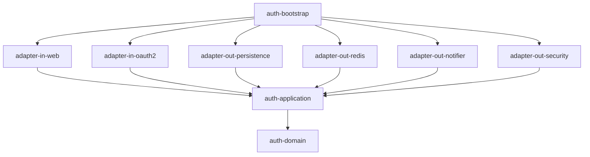

# mini-sso

[](https://github.com/kang30984/mini-sso/actions/workflows/ci.yml)

그룹사 임직원 포털 같은 환경을 가정하고 만든 SSO 인증 서버와, 각 서비스가 가져다 쓰는 토큰 검증 SDK다.

기능 개수보다는 여러 서비스가 의존하는 인증 기반을 만들 때 무엇을 고민해야 하는지에 초점을 뒀고, 중요한 결정은 [ADR](docs/adr/README.md)로 따로 정리했다.

주요 내용

- Spring Authorization Server 기반 인가 서버 (Authorization Code + PKCE, SSO, RP-Initiated / Back-Channel Logout)
- 리프레시 토큰 재사용 탐지, 서명 키 무중단 교체, 로그인 시도 제한
- 서비스용 SDK. 의존성과 설정 몇 줄만 추가하면 토큰 검증이 붙는다
- 부하 테스트에서 동시 로그인 버그를 찾아 고쳤고, 토큰 갱신 처리량을 약 12배 개선했다 ([성능](#성능))

## 기술 스택

| 영역 | 사용 기술 |
|---|---|
| 언어 | Kotlin (인증 서버), Java 21 (SDK) |
| 프레임워크 | Spring Boot 3.5, Spring Security 6, Spring Authorization Server |
| 데이터 | MySQL 8.4, JPA, QueryDSL, Flyway, Redis 7 |
| 빌드 | Gradle Kotlin DSL, Convention Plugin, Version Catalog |
| 테스트 | JUnit 5, AssertJ, Testcontainers, ArchUnit, MockMvc, k6 |
| CI | GitHub Actions. `.gitlab-ci.yml`도 같은 단계로 작성해 뒀지만 실제로 돌리는 건 GitHub Actions다 |

인증 서버는 Kotlin으로, SDK는 Java로 작성했다. SDK를 쓰는 서비스가 Java 프로젝트일 수도 있어서 kotlin-stdlib 의존성을 끌고 가지 않게 하려는 이유다 ([ADR-002](docs/adr/002-kotlin-server-java-sdk.md)).

## 구조

헥사고날 구조를 Gradle 모듈 단위로 나눴다. 도메인 모듈에는 Spring 의존성이 아예 없고, 어댑터끼리는 서로 참조하지 못하게 했다. 이 규칙은 ArchUnit 테스트로 확인한다.



| 모듈 | 역할 |
|---|---|
| `auth-domain` | 계정, 클라이언트, 서명 키 도메인 규칙 |
| `auth-application` | 유스케이스와 포트 |
| `auth-adapter-in-web` | 관리자 REST API, 오류 응답(ProblemDetail) |
| `auth-adapter-in-oauth2` | Spring Authorization Server 연동, 로그인 폼, 보안 설정 |
| `auth-adapter-out-persistence` | JPA, QueryDSL |
| `auth-adapter-out-redis` | 인가 상태 저장, 로그인 시도 제한 |
| `auth-adapter-out-notifier` | Back-Channel Logout 전송 |
| `auth-adapter-out-security` | Argon2 해시, 서명 키 생성과 암호화 |
| `auth-bootstrap` | 실행 진입점, 빈 조립 |
| `auth-sdk-core` | Spring 없이 쓸 수 있는 JWT 검증 |
| `auth-sdk-spring-boot-starter` | 자동 구성 SDK |
| `samples/sample-app-a` | 로그인하는 웹 서비스 (Java) |
| `samples/sample-app-b` | SDK로 보호되는 API 서비스 (Kotlin) |

처음 세운 설계는 [docs/DESIGN.md](docs/DESIGN.md)에 있다. 구현하면서 바뀐 부분은 문서 안에 표시해 뒀다.

## 실행

JDK 21과 Docker가 필요하다.

```bash
docker compose up -d                                                                    # MySQL, Redis
./gradlew :auth-server:auth-bootstrap:bootRun --args='--spring.profiles.active=local'   # 인증 서버 :9000
./gradlew :samples:sample-app-a:bootRun                                                 # 샘플 앱 A :8081
./gradlew :samples:sample-app-b:bootRun                                                 # 샘플 앱 B :8082
```

`local` 프로필로 띄우면 관리자 계정(`admin` / `Local-Passw0rd!`)과 샘플 앱 클라이언트가 자동으로 등록된다. 서명 키를 암호화하는 마스터 키도 이 프로필에만 데모용으로 들어 있고, 다른 환경에서는 `MINISSO_KEY_ENCRYPTION_KEY`를 지정하지 않으면 서버가 뜨지 않는다.

http://127.0.0.1:8081 에 접속하면 인증 서버 로그인 화면으로 이동한다. 로그인하고 돌아오면 토큰에 담긴 사용자 정보가 보이고, 그 토큰으로 샘플 앱 B의 API를 호출해 볼 수 있다. 로그아웃하면 인증 서버 세션까지 끊겨서 다시 접속할 때 로그인 화면이 나온다. 인증 서버(`localhost`)와 샘플 앱(`127.0.0.1`)은 쿠키를 공유하지 않도록 일부러 다른 호스트로 띄웠다.

테스트는 `./gradlew build`로 전부 돌릴 수 있다. 통합 테스트는 Testcontainers를 쓰기 때문에 Docker가 켜져 있어야 한다.

## 구현하면서 고민한 것들

### 로그인

계정은 5번 연속 실패하면 30분 잠긴다. 잠긴 동안에는 비밀번호 비교 자체를 하지 않는다. 비교를 계속 해 주면 잠금이 있어도 공격자가 정답 여부를 확인할 수 있기 때문이다.

없는 계정으로 로그인해도 실제 Argon2 비교를 한 번 수행한다. 이렇게 하지 않으면 응답 시간 차이로 계정이 있는지 없는지 알 수 있다. 같은 이유로 "없는 계정", "탈퇴 계정", "비밀번호 오류"는 모두 같은 메시지를 보여준다.

로그인 실패는 예외 대신 결과값으로 돌려준다. 예외를 던지면 트랜잭션이 롤백되면서 실패 횟수와 로그인 이력까지 같이 사라진다.

IP당 로그인 시도는 분당 20회로 제한했다. 이 검사를 Argon2 비교보다 앞에 둬서, 차단된 요청이 CPU를 쓰지 않게 했다.

### 토큰

모든 클라이언트에 PKCE를 강제했다. 기밀 클라이언트라도 인가 코드가 로그나 브라우저 기록으로 새어 나갈 수 있어서다. 사내 서비스만 등록한다는 전제로 동의 화면은 생략했다 ([ADR-010](docs/adr/010-first-party-clients-pkce.md)).

리프레시 토큰은 쓸 때마다 새로 발급하고, 이미 교체된 토큰이 다시 들어오면 그 로그인에서 이어진 토큰을 전부 폐기한다. 서버 입장에서는 탈취한 쪽과 정상 사용자를 구분할 방법이 없기 때문이다. 대신 클라이언트가 같은 요청을 두 번 보내면 정상 사용자도 로그아웃되는 부작용이 있다 ([ADR-007](docs/adr/007-refresh-token-reuse-detection.md)).

로그아웃하면 해당 세션으로 발급된 토큰을 먼저 폐기하고, 그다음 그 세션으로 로그인했던 서비스들에 Back-Channel Logout 토큰을 보낸다. 순서를 이렇게 둔 건 알림 전송이 실패하더라도 그 서비스가 다음 토큰 갱신 때는 로그아웃되도록 하기 위해서다.

토큰의 `sub`에는 바뀌지 않는 계정 ID를 넣었다. 로그인 ID나 이메일은 바뀔 수 있다. 액세스 토큰에는 권한(`roles`)만 넣고 이메일 같은 개인정보는 ID 토큰에만 담았다.

### 저장소

인가 상태와 로그인 세션은 Redis에 저장한다. 토큰 만료 시각을 그대로 TTL로 쓰면 되니까 만료 데이터를 지우는 배치가 필요 없다. 키에는 토큰 원문 대신 SHA-256 해시를 쓴다 ([ADR-004](docs/adr/004-authorization-state-in-redis.md)).

도메인 모델과 JPA 엔티티는 분리했고, 스키마는 Flyway로 관리한다. Hibernate는 엔티티와 스키마가 맞는지 확인만 한다. 로그인 이력 검색은 조건이 동적으로 바뀌어서 QueryDSL로 작성했고, 이력이 계속 쌓이는 테이블이라 커서 기반 페이징을 쓰고 조회 기간은 최대 31일로 제한했다.

### 서명 키 교체

서명 키는 DB에 AES-256-GCM으로 암호화해서 저장한다. 키를 교체하면 새 키로 바로 서명을 시작하고, 이전 키는 1시간 동안 JWKS에 남겨 둔다. 이미 발급된 토큰이 교체 직후에 검증 실패하지 않게 하기 위해서다. 실제 JWKS 엔드포인트를 SDK로 조회해서 교체 전 토큰과 교체 후 토큰이 둘 다 검증되는지 통합 테스트로 확인한다 ([ADR-008](docs/adr/008-signing-key-rotation.md)).

### SDK

SDK는 순수 Java로 된 core와 Spring Boot Starter로 나눴다. 검증 로직은 core에만 있고, starter는 Spring과 연결하는 역할만 한다. 서비스는 아래처럼 쓰면 된다.

```kotlin
// build.gradle.kts
implementation(project(":auth-sdk:auth-sdk-spring-boot-starter"))
```

```yaml
mini-sso:
  issuer-uri: http://localhost:9000
  audiences: [ sample-app-a ]
  public-paths: [ /api/public/** ]
```

```kotlin
@GetMapping("/me")
fun me(@CurrentUser user: AuthUser) = mapOf("accountId" to user.accountId())

@RequiresScope("profile")
@GetMapping("/team-reports")
fun teamReports(@CurrentUser user: AuthUser) = ...
```

공개키(JWKS)는 캐시해 두고, 모르는 키 ID가 오면 다시 받아온다. 다만 위조 토큰이 몰려도 인증 서버로 요청이 폭주하지 않게 재조회 간격에 제한을 뒀다. 인증 서버가 잠깐 죽어도 캐시된 키로 검증은 계속된다 ([ADR-005](docs/adr/005-local-jwt-verification.md)). SDK가 만드는 빈은 서비스에서 직접 정의하면 덮어쓸 수 있고, `issuer-uri`를 빠뜨리면 서버가 뜰 때 바로 실패한다.

## 테스트

| 종류 | 대표 테스트 | 확인하는 것 |
|---|---|---|
| 도메인 | `AccountTest`, `OAuthClientTest` | 잠금 정책, 비밀번호 정책, 리다이렉트 URI 정책 |
| 유스케이스 | `LoginServiceTest`, `SigningKeyServiceTest` | 가짜 포트로 시나리오 검증 |
| 어댑터 | `*PersistenceAdapterIT`, `RedisOAuth2AuthorizationServiceIT` | 실제 MySQL, Redis |
| OIDC 흐름 | `AuthorizationCodeFlowIT` | 인가 코드 + PKCE, SSO, 토큰 재사용 탐지, 로그아웃 |
| 키 교체 | `KeyRotationIT` | 교체 전후 토큰 검증 |
| 동시성 | `ConcurrentLoginIT` | 같은 계정 동시 로그인 |
| 아키텍처 | `HexagonalArchitectureTest` | 모듈 간 의존 규칙 |

## 성능

k6로 시나리오 네 개(전체 로그인 흐름, 토큰 갱신, SDK로 보호되는 API, JWKS 조회)를 만들고 GitHub Actions에서 돌렸다. 러너 한 대에 MySQL, Redis, 서버, k6를 전부 올려서 돌리는 거라 절대 수치는 낮게 나온다. 같은 환경에서 전후를 비교하는 용도로 봐야 한다. 실행 방법은 [load-test/README.md](load-test/README.md)에 있다.

### 처음 돌렸을 때

| 시나리오 | 처리량 | 평균 지연 | 실패율 |
|---|---|---|---|
| JWKS 조회 (기준선) | 8,704 req/s | 5.6ms | 0% |
| 전체 로그인 흐름 | 19.2 회/s | 918ms | 26.5% |
| 토큰 갱신 | 23.4 회/s | 823ms | 6.8% |
| SDK로 보호되는 API | 3,934 req/s | 12.5ms | 0% |

로그인 실패율이 26%나 나와서 서버 로그를 봤더니, 오류 1,447건이 전부 같은 계정의 낙관적 락 충돌이었다. 테스트에서 가상 사용자 20명이 모두 같은 계정으로 로그인했고, 로그인할 때마다 마지막 로그인 시각을 갱신하면서 서로 부딪힌 것이다. 이 예외가 인증 실패로 처리되지 않고 500으로 나가고 있었다. 테스트 시나리오가 비현실적이긴 했지만, 더블클릭이나 여러 기기에서 동시에 로그인하는 경우에도 생길 수 있는 문제라 고쳤다. 마지막 로그인 시각은 낙관적 락 대상에서 빼고, 실패 횟수처럼 보안에 필요한 값의 충돌만 한 번 재시도하도록 했다 ([ADR-011](docs/adr/011-concurrent-login-optimistic-lock.md)).

다른 하나는 토큰 갱신이었다. 갱신 요청에는 비밀번호 비교가 없는데도 로그인만큼 느렸다. 원인은 클라이언트 인증이었다. 토큰을 요청할 때마다 클라이언트 시크릿을 Argon2로 검증하고 있었는데, Argon2는 일부러 느리게 만든 알고리즘이다. 이게 CPU를 잡고 있다 보니 Argon2와 상관없는 단계까지 기준선보다 30배 가까이 느려졌다.

### 고친 뒤

동시 로그인 문제를 고치고 테스트 계정을 100개로 나눈 다음, 같은 커밋에서 클라이언트 시크릿 캐시만 끄고 켜서 두 번 측정했다. 캐시는 검증에 성공한 시크릿만 10분 동안 기억하는 방식이다. 저장은 계속 Argon2로 하고 틀린 시크릿은 캐시하지 않으니까, DB가 유출되거나 무차별 대입을 당했을 때의 방어 수준은 그대로다 ([ADR-012](docs/adr/012-verified-client-secret-cache.md)).

| 지표 | 캐시 끔 | 캐시 켬 |
|---|---|---|
| 토큰 갱신 처리량 | 23.8 회/s | 289.1 회/s |
| 토큰 갱신 평균 / p95 | 800ms / 1,018ms | 67ms / 98ms |
| 토큰 교환(인가 코드) 평균 | 803ms | 197ms |
| 전체 로그인 흐름 처리량 | 9.7 회/s | 18.2 회/s |
| SDK로 보호되는 API | 4,051 req/s | 4,470 req/s |

토큰 갱신 처리량이 약 12배 늘었다. 토큰 요청이 가벼워지면서 CPU 경합이 줄어든 덕분에, 캐시와 직접 관련이 없는 로그인 흐름도 1.9배 빨라졌다. 로그인 단계(약 500ms)는 여전히 제일 느린데, 계정 비밀번호는 일부러 비싸게 검증하는 거라 손대지 않았다.

측정하면서 한 가지 착오도 있었다. 고친 뒤에도 토큰 갱신 실패율이 0.56%와 5.99%로 나왔는데, 처리량이 12배 차이 나는 두 실행에서 실패 건수가 둘 다 약 100건으로 같았다. 측정 구간 밖에서 생긴 실패라는 뜻이라 찾아보니, 앞 시나리오에서 이미 만든 테스트 계정을 다시 만들려다 받은 409 응답이 실패로 집계된 것이었다. 스크립트를 고쳤고, 실제 실패는 0건이다.

## 트러블슈팅

CI와 부하 테스트에서 실제로 막혔던 문제 8건을 [docs/troubleshooting.md](docs/troubleshooting.md)에 정리했다. 테스트가 엉뚱한 이유로 통과하고 있던 일이나, 규격이 권장하는 방식대로 했더니 라이브러리가 토큰을 거부한 일 같은 것들이다.

## 아직 남은 것

운영 환경에 가져가려면 아래 작업이 더 필요하다.

- Spring Authorization Server가 세션 식별에 쓰는 `SessionRegistry`가 메모리 구현이다. 서버를 여러 대 띄우려면 Redis 기반으로 바꿔야 한다 ([ADR-004](docs/adr/004-authorization-state-in-redis.md))
- 액세스 토큰은 서비스가 로컬에서 검증하기 때문에, 한 번 발급되면 만료(10분)까지 회수할 수 없다 ([ADR-005](docs/adr/005-local-jwt-verification.md))
- 서명 키를 미리 게시해 두고 나중에 쓰기 시작하는 단계, 정기 교체 스케줄러가 없다 ([ADR-008](docs/adr/008-signing-key-rotation.md))
- 인가 상태를 JDK 직렬화로 저장하고 있어서, 클래스 구조가 바뀌는 배포에서는 기존 로그인이 풀릴 수 있다
- 클라이언트 등록 API, 로그인 이력 보존 기간 정책, SDK 공개 API 호환성 검사, 토큰 검증 메트릭도 아직 없다
