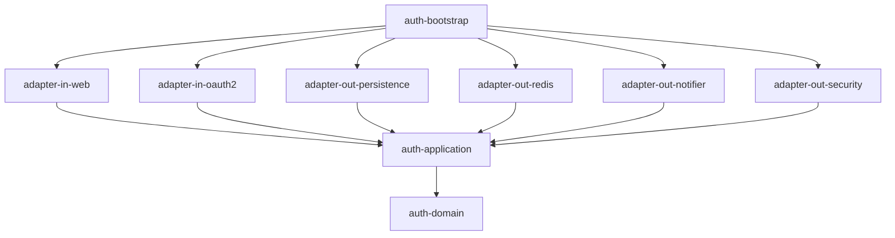

# mini-sso

[](https://github.com/kang30984/mini-sso/actions/workflows/ci.yml)

대규모 그룹사 임직원 포털을 가정한 **SSO 인증 서버**와, 여러 서비스가 의존하는 **공통 인증 SDK**를 축소 재현한 프로젝트입니다.

기능 구현보다 **"여러 서비스가 기대는 인증 기반을 어떻게 설계하는가"**에 초점을 둡니다. 모든 주요 결정은 [ADR](docs/adr/README.md)로 남깁니다.

## 핵심 목표

- OAuth2 Authorization Code + PKCE, OIDC 기반 SSO (서로 다른 오리진의 서비스 간 자동 로그인)
- Refresh Token Rotation과 재사용 탐지 시 토큰 계보 전체 폐기
- 무중단 서명키 로테이션, Back-Channel Logout
- 의존성 1줄과 설정 3줄로 동작하는 Spring Boot Starter SDK
- 헥사고날 아키텍처를 멀티모듈과 ArchUnit으로 강제
- k6 부하 테스트 결과를 수치로 기록

## 기술 스택

| 영역 | 사용 기술 |
|---|---|
| 언어 | Kotlin (인증 서버), Java 21 (SDK) |
| 프레임워크 | Spring Boot 3.5, Spring Security 6, Spring Authorization Server |
| 데이터 | MySQL 8.4, JPA, QueryDSL, Redis 7 |
| 빌드 | Gradle Kotlin DSL, Convention Plugin, Version Catalog |
| 테스트 | JUnit 5, Testcontainers, ArchUnit, WireMock, k6 |
| CI/CD | GitLab CI/CD (주), GitHub Actions (보조) |

## 아키텍처



| 모듈 | 책임 |
|---|---|
| `auth-domain` | 계정·세션·서명키 도메인 규칙 (프레임워크 의존 없음) |
| `auth-application` | 유스케이스와 포트 |
| `auth-adapter-in-web` | REST API, 로그인 페이지 |
| `auth-adapter-in-oauth2` | Spring Authorization Server 연동 |
| `auth-adapter-out-persistence` | JPA / QueryDSL |
| `auth-adapter-out-redis` | SSO 세션, 인가 상태, Rate Limit |
| `auth-adapter-out-notifier` | Back-Channel Logout 발송 |
| `auth-adapter-out-security` | Argon2id 비밀번호 해시 |
| `auth-bootstrap` | 실행 진입점, 빈 조립, 아키텍처 테스트 |
| `auth-sdk-core` | Spring 의존 없는 JWT 검증 |
| `auth-sdk-spring-boot-starter` | AutoConfiguration 기반 SDK |

자세한 설계는 [docs/DESIGN.md](docs/DESIGN.md)를 참고하세요.

## 로컬 실행

요구 사항: JDK 21, Docker

```bash
docker compose up -d                                  # MySQL, Redis
./gradlew :auth-server:auth-bootstrap:bootRun         # http://localhost:9000/actuator/health
```

테스트

```bash
./gradlew test               # 단위 테스트 + ArchUnit
./gradlew integrationTest    # Testcontainers 통합 테스트 (Docker 필요)
```

## 로드맵

- [x] 1주차: 멀티모듈 골격, Convention Plugin, docker-compose, CI, 아키텍처 테스트
- [x] 2주차: 계정 도메인, JPA/QueryDSL 어댑터, 계정 API
- [ ] 3주차: Spring Authorization Server 연동, Authorization Code + PKCE, OIDC
- [ ] 4주차: Redis SSO 세션, Refresh Token 회전·재사용 탐지, 로그아웃
- [ ] 5주차: SDK core·starter, 서명키 로테이션, 샘플 앱 2개
- [ ] 6주차: k6 부하 테스트와 성능 개선, 문서 정리

## 구현 하이라이트

**계정 잠금 정책 (도메인 규칙)**
- 5회 연속 실패 시 30분 잠금. 잠긴 동안에는 비밀번호 비교 자체를 하지 않아 무차별 대입을 차단
- 잠금 시 실패 횟수를 초기화해, 잠금이 풀린 뒤 한 번의 실수로 바로 재잠금되지 않음
- 정책 값은 `minisso.account.*` 설정으로 조정

**계정 존재 여부 노출 방지**
- 존재하지 않는 계정에도 실제 Argon2 해시 비교를 수행해 응답 시간 차이를 줄임
- 실패 사유는 감사 이력에만 남기고, 사용자 메시지는 통일 (3주차 로그인 화면)

**실패도 커밋되는 로그인**
- 로그인 실패를 예외가 아닌 결과값으로 반환. 예외로 처리하면 트랜잭션 롤백으로 실패 횟수와 이력이 사라지기 때문

**영속성**
- 도메인 모델과 JPA 엔티티 분리, 스키마는 Flyway로 관리하고 Hibernate는 `validate`만 수행
- 로그인 이력 검색은 QueryDSL 동적 조건 + No-Offset 커서 페이징, 조회 기간 최대 31일 강제
- 동시 가입 시 유니크 제약 위반을 도메인 에러 코드로 변환, 계정 수정은 `@Version` 낙관적 락

**API**
- 오류 응답은 RFC 9457 ProblemDetail + 자체 코드 ([에러 코드 목록](docs/error-codes.md))
- 비밀번호가 담긴 요청·커맨드 객체는 `toString`에서 마스킹

## API 예시

```bash
# 계정 생성
curl -X POST localhost:9000/api/admin/v1/accounts -H 'Content-Type: application/json' -d '{
  "loginId": "kim.cs", "email": "kim.cs@example.com",
  "name": "김철수", "department": "보안팀", "initialPassword": "Sso-Passw0rd!"
}'

# 잠금 해제
curl -X POST localhost:9000/api/admin/v1/accounts/1/unlock

# 로그인 이력 검색 (다음 페이지는 응답의 nextCursor를 cursor로 전달)
curl 'localhost:9000/api/admin/v1/login-histories?from=2026-10-01T00:00:00Z&to=2026-10-31T00:00:00Z&outcome=FAILURE&size=20'
```

> 관리자 API 인증은 3주차에 Spring Security와 함께 적용합니다.

## 성능 측정

> 6주차에 측정 환경과 함께 p95 응답시간, TPS를 기록합니다.
