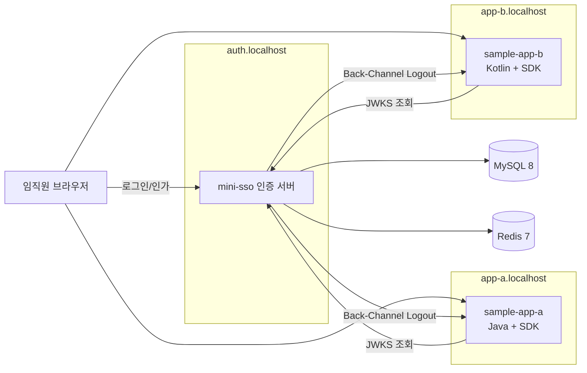
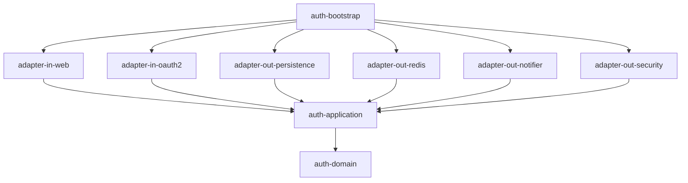
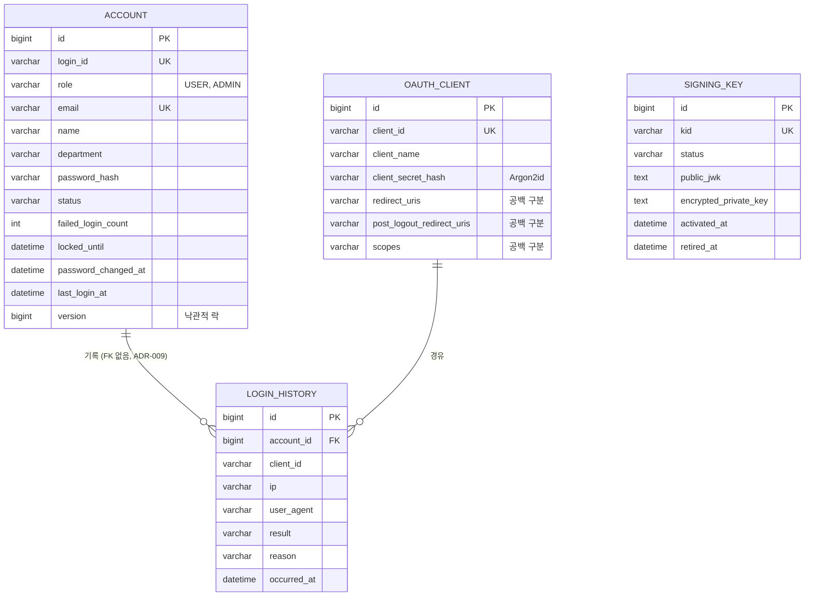
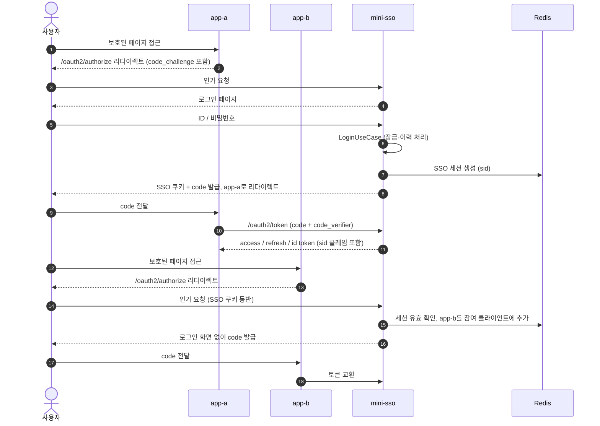
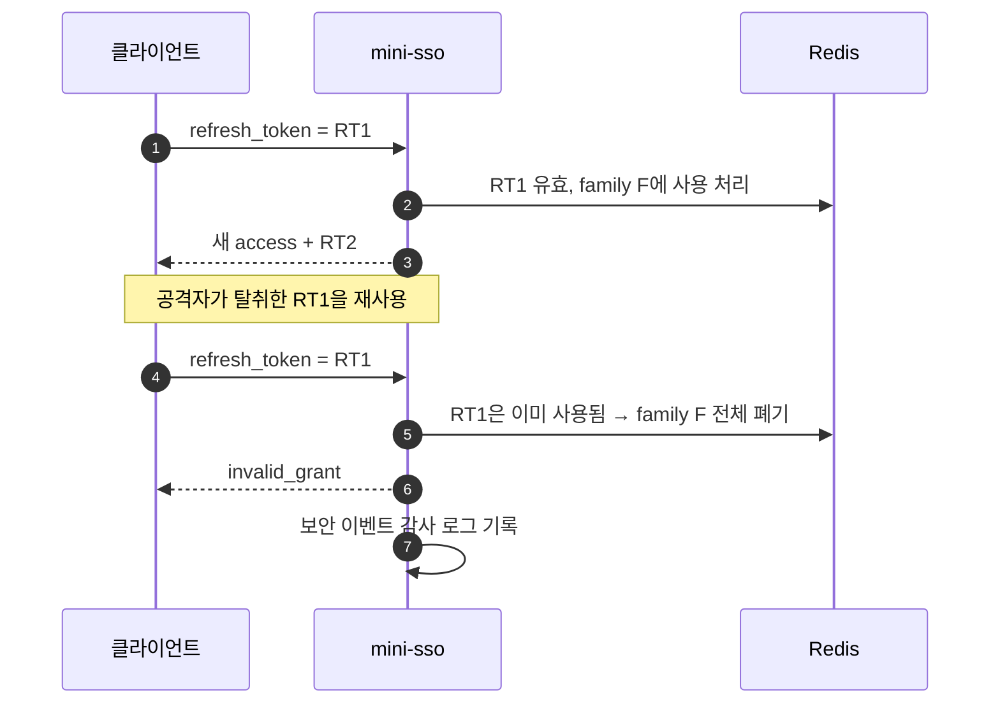
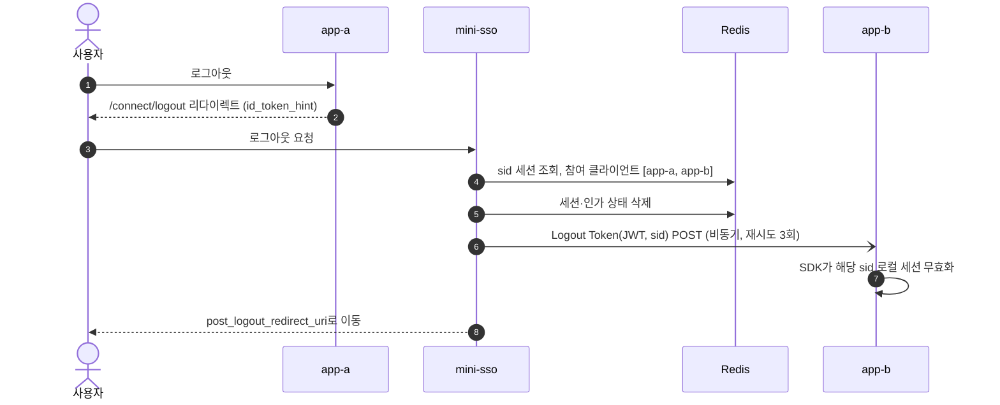

# mini-sso 설계 문서

> 그룹사 임직원 포털용 **SSO 인증 서버 + 공통 인증 SDK**를 축소 재현한 프로젝트
> Java 21 / Kotlin · Spring Boot 3.x · Spring Authorization Server · Hexagonal · JPA/QueryDSL · Redis · GitLab CI/CD

---

## 1. 목적과 공고 요건 매핑

이 프로젝트의 목적은 "기능을 만들 줄 안다"가 아니라 **"여러 서비스가 의존하는 인증 기반과 SDK를 설계할 줄 안다"**를 보여주는 것이다.

| 공고 요건 | 이 프로젝트에서 증명하는 방법 |
|---|---|
| Java / Kotlin | 인증 서버는 Kotlin, SDK는 Java 21 (선택 이유는 ADR-002) |
| Spring Boot 3.x | 전 모듈 Spring Boot 3.x, Spring Security 6 |
| OAuth2 / OIDC / SSO | Authorization Code + PKCE, ID Token, SSO 세션, Back-Channel Logout |
| REST API 설계 | 계정·관리자 API, RFC 9457 ProblemDetail 에러 규약, 버저닝 |
| JPA / QueryDSL | 계정·클라이언트·서명키 영속화, 로그인 이력 동적 검색 |
| 멀티모듈 | Gradle Kotlin DSL + Convention Plugin + Version Catalog |
| Hexagonal (우대) | 포트/어댑터 분리, ArchUnit으로 의존 방향 강제 |
| Redis 캐시·세션 (우대) | SSO 세션, 인가 상태, 로그인 Rate Limit, JWKS 캐시 |
| GitLab CI/CD (우대) | `.gitlab-ci.yml` 빌드·테스트·SDK 배포 파이프라인 |
| 대규모 트래픽 (우대) | k6 부하 테스트 결과를 README에 수치로 기록 |
| SDK 설계 품질 | AutoConfiguration, 오버라이드 가능 설계, 공개 API 호환성 검사 |

## 2. 범위

**포함**
- 계정 가입·로그인·잠금·해제, 비밀번호 변경
- OAuth2 Authorization Code + PKCE, Refresh Token Rotation(재사용 탐지 포함)
- OIDC: ID Token, UserInfo, Discovery, JWKS, RP-Initiated Logout, Back-Channel Logout
- 서명키 로테이션 (무중단)
- 로그인 이력·감사 로그 조회 (관리자)
- 리소스 서버용 SDK (Spring Boot Starter)
- 샘플 서비스 2개로 SSO 시연

**제외 (README에 "향후 과제"로 명시)**
- MFA, 소셜 로그인, 관리자 UI(프론트엔드), 다중 리전

## 3. 시스템 구성



- 로컬 환경은 `docker-compose`로 MySQL, Redis, 인증 서버, 샘플 앱 2개를 띄운다.
- 인증 서버(`localhost:9000`)와 샘플 앱(`127.0.0.1:8081`, `127.0.0.1:8082`)을 서로 다른 호스트로 띄워 **쿠키를 공유하지 않는 오리진 간 SSO**가 실제로 동작함을 보인다 (인증 서버 세션 기반 SSO).
  - 처음에는 `*.localhost` 서브도메인을 계획했으나, 브라우저와 달리 JVM과 Windows 리졸버는 서브도메인을 루프백으로 해석하지 않을 수 있어 변경했다.
  - 같은 호스트(127.0.0.1)의 샘플 앱끼리는 세션 쿠키 이름을 다르게 지정해 충돌을 막는다.

## 4. 모듈 구조

```
mini-sso/
├── build-logic/                      # Gradle Convention Plugin (kotlin-conventions, java-library-conventions 등)
├── gradle/libs.versions.toml         # Version Catalog
├── auth-server/
│   ├── auth-domain/                  # Kotlin, 프레임워크 의존 없음
│   ├── auth-application/             # Kotlin, 유스케이스 + 포트
│   ├── auth-adapter-in-web/          # REST API, 로그인 페이지
│   ├── auth-adapter-in-oauth2/       # Spring Authorization Server 설정·커스터마이징
│   ├── auth-adapter-out-persistence/ # JPA, QueryDSL
│   ├── auth-adapter-out-redis/       # SSO 세션, 인가 상태, Rate Limit
│   ├── auth-adapter-out-notifier/    # Back-Channel Logout 발송
│   ├── auth-adapter-out-security/    # Argon2id 비밀번호 해시
│   └── auth-bootstrap/               # main, 빈 조립, 설정 파일
├── auth-sdk/
│   ├── auth-sdk-core/                # Java 21, 순수 JWT 검증 (Spring 의존 없음)
│   └── auth-sdk-spring-boot-starter/ # AutoConfiguration
├── samples/
│   ├── sample-app-a/                 # Java
│   └── sample-app-b/                 # Kotlin
├── load-test/                        # k6 스크립트
├── docs/adr/                         # 설계 결정 기록
├── docker-compose.yml
└── .gitlab-ci.yml
```

### 4.1 의존 방향



규칙 (ArchUnit 테스트로 강제)
1. `auth-domain`은 어떤 모듈·프레임워크에도 의존하지 않는다.
2. `auth-application`은 `auth-domain`에만 의존한다. 예외로 `spring-tx`의 `@Transactional`만 허용 (ADR-006).
3. 어댑터끼리는 서로 의존하지 않는다. 오직 `application`의 포트를 통해 연결된다.
4. JPA 엔티티는 `adapter-out-persistence` 밖으로 나가지 않는다. 도메인 모델과 엔티티는 매퍼로 변환한다.
5. 빈 조립은 `auth-bootstrap`에서만 한다.

### 4.2 Spring Authorization Server를 헥사고날에 넣는 방법

Spring Authorization Server(이하 SAS)는 자체 확장 인터페이스를 가지고 있다. 이를 **우리 포트를 호출하는 어댑터**로 구현해 프레임워크가 도메인을 침범하지 않게 한다.

| SAS 확장 지점 | 구현 위치 | 위임 대상 포트 |
|---|---|---|
| `UserDetailsService` / `AuthenticationProvider` | adapter-in-oauth2 | `LoginUseCase` |
| `RegisteredClientRepository` | adapter-out-persistence | `LoadClientPort` |
| `OAuth2AuthorizationService` | adapter-out-redis | (인가 상태 저장 전용) |
| `JWKSource` | adapter-out-persistence | `LoadSigningKeyPort` |
| `OAuth2TokenCustomizer` | adapter-in-oauth2 | `LoadAccountPort` (클레임 구성) |

### 4.3 패키지 구조 (auth-application 예시)

```
io.github.kang30984.minisso.application
├── account
│   ├── port.inbound   # RegisterAccountUseCase, LoginUseCase, UnlockAccountUseCase ...
│   ├── port.outbound  # LoadAccountPort, SaveAccountPort, PasswordHasherPort ...
│   └── service        # 유스케이스 구현
├── session
├── signingkey
└── history
```

어댑터 패키지는 `io.github.kang30984.minisso.adapter.{inbound|outbound}.{이름}` 규칙을 따른다 (예: `adapter.outbound.redis`). `in`은 Kotlin 예약어라 패키지명에 쓰면 백틱이 필요하므로 `inbound`/`outbound`로 통일했다. ArchUnit의 어댑터 간 의존 금지 규칙도 이 패턴을 기준으로 동작한다.

## 5. 도메인 모델

### 5.1 Account (애그리거트 루트)

| 필드 | 설명 |
|---|---|
| `id` | 내부 식별자 |
| `loginId` | 사번 형식 로그인 ID (유니크) |
| `email`, `name`, `department` | ID Token / UserInfo 클레임 원천 |
| `passwordHash` | Argon2id 해시 |
| `status` | `ACTIVE`, `DORMANT`, `WITHDRAWN` (잠금은 시간이 지나면 풀리는 일시 상태라 `lockedUntil`로 표현) |
| `failedLoginCount`, `lockedUntil` | 잠금 정책 상태 |
| `passwordChangedAt`, `lastLoginAt` | 비밀번호 만료·휴면 판단 |

도메인 규칙은 엔티티 메서드로 표현한다 (빈약한 도메인 모델 지양).

```kotlin
class Account(/* ... */) {
    fun authenticate(raw: String, hasher: PasswordHasher, now: Instant): LoginResult {
        if (status == WITHDRAWN) return LoginResult.Rejected(Reason.NOT_FOUND)   // 존재 여부 노출 방지
        if (isLocked(now)) return LoginResult.Rejected(Reason.LOCKED)
        if (!hasher.matches(raw, passwordHash)) {
            recordFailure(now)            // 5회 실패 시 30분 잠금
            return LoginResult.Rejected(Reason.BAD_CREDENTIALS)
        }
        recordSuccess(now)
        return if (isPasswordExpired(now)) LoginResult.PasswordChangeRequired
               else LoginResult.Success
    }
}
```

### 5.2 기타 도메인

- **OAuthClient**: `clientId`, 시크릿 해시, `redirectUris`, `postLogoutRedirectUris`, `scopes` (PKCE와 grant type은 모든 클라이언트 공통 정책, ADR-010. `backchannelLogoutUri`는 4주차에 추가)
- **AccountRole**: `USER`, `ADMIN`. 액세스 토큰의 `roles` 클레임으로 발급되어 관리자 API 접근을 제어한다
- **SigningKey**: `kid`, `status`(`ACTIVE` → `RETIRING` → `RETIRED`), 공개키 JWK, 암호화된 개인키, `activatedAt`
- **SsoSession**: `sid`, `accountId`, `authTime`, 참여 클라이언트 목록 (Redis에만 존재)
- **LoginHistory**: `accountId`, `clientId`, `ip`, `userAgent`, `result`, `reason`, `occurredAt`

## 6. 데이터 설계

### 6.1 ERD (MySQL)



인덱스
- `login_history (account_id, occurred_at)`: 계정별 이력 조회
- `login_history (occurred_at, result)`: 관리자 기간·결과 검색
- 로그인 이력은 쓰기가 많으므로 월 단위 파티셔닝 고려사항을 ADR로 남긴다.

### 6.2 QueryDSL 사용처

단순 CRUD는 Spring Data JPA, **조건이 동적인 조회만 QueryDSL**로 작성한다.

- 관리자 로그인 이력 검색: 기간, 결과, 클라이언트, IP, 로그인 ID(부분 일치) 조합 + 페이징
- 관리자 계정 검색: 상태, 부서, 마지막 로그인 기준 휴면 후보 조회
- 페이징은 Count 쿼리 분리 + No-Offset(커서) 방식 비교 결과를 README에 기록

### 6.3 Redis 키 설계

| 키 | 타입 | TTL | 용도 |
|---|---|---|---|
| `sso:session:{sid}` | Hash | 8시간 (절대 만료) | SSO 세션 본문 |
| `sso:account:{accountId}:sessions` | Set | 세션과 동일 | 계정별 세션 목록 (강제 로그아웃용) |
| `sso:session:{sid}:clients` | Set | 세션과 동일 | 로그아웃 통지 대상 클라이언트 |
| `oauth2:authz:{id}` | String(JSON) | 토큰 최대 만료 | SAS 인가 상태 |
| `oauth2:authz:idx:{type}:{sha256(token)}` | String | 토큰 만료 | 토큰 → 인가 ID 역색인 |
| `oauth2:rt:family:{familyId}` | Set | 14일 | Refresh Token 계보 (재사용 탐지) |
| `ratelimit:login:ip:{ip}` | String(INCR) | 1분 | 로그인 시도 제한 |

원칙
- 토큰 원문은 저장하지 않고 SHA-256 해시를 키로 쓴다.
- 여러 키를 함께 바꾸는 작업은 Lua 스크립트나 `MULTI`로 원자성을 보장한다.
- Redis 장애 시: SSO 세션이 사라지면 재로그인으로 복구된다는 점을 명시하고, 인가 서버 기동은 막지 않는다.

## 7. 핵심 흐름

### 7.1 SSO 로그인 (앱 A 로그인 후 앱 B 자동 로그인)



### 7.2 Refresh Token Rotation + 재사용 탐지



SAS의 `reuseRefreshTokens(false)`로 회전은 기본 지원되지만, **재사용 탐지 시 계보 전체 폐기는 직접 구현**한다. 이 부분이 프로젝트의 보안 설계 포인트다.

### 7.3 로그아웃 (RP-Initiated + Back-Channel)



SAS는 RP-Initiated Logout을 제공한다. Back-Channel Logout 토큰 발송은 직접 구현하는 것을 전제로 설계하고, 수신 측은 SDK가 담당한다.

## 8. API 설계

### 8.1 표준 엔드포인트 (SAS 제공)

`/.well-known/openid-configuration`, `/oauth2/authorize`, `/oauth2/token`, `/oauth2/jwks`, `/oauth2/revoke`, `/oauth2/introspect`, `/userinfo`, `/connect/logout`

### 8.2 커스텀 REST API

| 메서드 | 경로 | 권한 | 설명 |
|---|---|---|---|
| POST | `/api/admin/v1/accounts` | 관리자 | 계정 생성 (임직원 등록) |
| GET | `/api/admin/v1/accounts/{id}` | 관리자 | 계정 조회 (잠금 여부 포함) |
| GET | `/api/v1/accounts/me` | 본인 | 내 정보 |
| PATCH | `/api/v1/accounts/me/password` | 본인 | 비밀번호 변경 (현재 비밀번호 확인) |
| POST | `/api/admin/v1/accounts/{id}/unlock` | 관리자 | 잠금 해제 |
| GET | `/api/admin/v1/login-histories` | 관리자 | 이력 검색 (QueryDSL, 커서 페이징) |
| GET | `/api/admin/v1/accounts/{id}/sessions` | 관리자 | 활성 SSO 세션 목록 |
| DELETE | `/api/admin/v1/sessions/{sid}` | 관리자 | 강제 로그아웃 |
| POST | `/api/admin/v1/signing-keys/rotate` | 관리자 | 서명키 로테이션 |

### 8.3 API 규약

- URI 버저닝 (`/v1`), 리소스 명사 복수형, 상태 변경 행위는 하위 리소스 동사(`/unlock`, `/rotate`)로 제한
- 에러 응답은 RFC 9457 `ProblemDetail` + 자체 `code` 필드

```json
{
  "type": "https://mini-sso.dev/errors/account-locked",
  "title": "Account locked",
  "status": 423,
  "code": "AUTH-4231",
  "detail": "로그인 실패 횟수 초과로 계정이 잠겼습니다.",
  "instance": "/api/v1/accounts/me"
}
```

- 에러 코드는 `docs/error-codes.md`에 일괄 정리 (SDK에서도 동일 코드 체계 사용)
- API 문서는 springdoc-openapi로 생성

## 9. SDK 설계

이 프로젝트에서 가장 공들일 부분이다. "그룹 내 여러 서비스가 이 SDK 위에서 동작한다"는 전제로 설계한다.

### 9.1 사용 경험 (목표)

```kotlin
// build.gradle.kts
implementation("io.github.kang30984.minisso:auth-sdk-spring-boot-starter:1.0.0")
```

```yaml
# application.yml
mini-sso:
  issuer-uri: http://auth.localhost:9000
  audience: app-a
  public-paths: [ "/health", "/public/**" ]
```

```java
@GetMapping("/me")
public MyInfo me(@CurrentUser AuthUser user) {          // SDK 제공
    return new MyInfo(user.loginId(), user.department());
}

@RequiresScope("approval:write")                          // SDK 제공
@PostMapping("/approvals")
public void approve() { ... }
```

설정 3줄과 의존성 1줄로 토큰 검증, 사용자 주입, 권한 검사, 표준 에러 응답, 로그아웃 수신까지 동작해야 한다.

### 9.2 모듈 분리

| 모듈 | 의존성 | 책임 |
|---|---|---|
| `auth-sdk-core` | JDK + nimbus-jose-jwt | JWT 서명·클레임 검증, JWKS 캐시, `AuthUser` 모델 |
| `auth-sdk-spring-boot-starter` | core + Spring Security (compileOnly 위주) | AutoConfiguration, 필터 체인, 어노테이션, 에러 핸들링 |

core를 분리한 이유: Spring이 아닌 배치나 게이트웨이에서도 검증 로직을 재사용할 수 있게 하기 위함.

### 9.3 설계 원칙

1. **오버라이드 가능**: 모든 빈은 `@ConditionalOnMissingBean`. 서비스가 자체 `SecurityFilterChain`을 정의하면 SDK 기본값은 물러난다.
2. **공개 API 최소화**: 공개 패키지는 `api`, 나머지는 `internal`. 공개 타입은 `AuthUser`, `@CurrentUser`, `@RequiresScope`, `MiniSsoProperties` 정도로 제한.
3. **하위 호환성**: SemVer 준수. 공개 API 변경은 japicmp 플러그인으로 CI에서 검출해 Major 변경 없이 깨지면 빌드 실패.
4. **장애 격리**: JWKS 조회 실패 시 캐시된 키로 계속 검증. 모르는 `kid`가 오면 재조회하되 최소 간격(예: 30초)을 둬 인증 서버로 요청 폭주를 막는다.
5. **관측 가능성**: Micrometer 메트릭 (`minisso.token.verify{result=success|expired|invalid}`), 실패 사유 디버그 로그.
6. **설정 검증**: `@Validated` 프로퍼티로 issuer 누락 시 기동 실패 (런타임이 아닌 기동 시점에 오류 발견).

### 9.4 AutoConfiguration 구성

```
MiniSsoAutoConfiguration
├── JwksKeyProvider            (core, 캐시·재조회 정책)
├── MiniSsoJwtDecoder          (issuer, audience, 만료 허용 오차 검증)
├── SecurityFilterChain        (@ConditionalOnMissingBean)
├── CurrentUserArgumentResolver
├── RequiresScopeInterceptor
├── ProblemDetailAuthenticationEntryPoint / AccessDeniedHandler
└── BackchannelLogoutEndpoint  (mini-sso.backchannel-logout.enabled=true 일 때)
```

등록은 `META-INF/spring/org.springframework.boot.autoconfigure.AutoConfiguration.imports`로 한다.

## 10. 보안 설계

| 항목 | 정책 |
|---|---|
| 비밀번호 저장 | Argon2id, `DelegatingPasswordEncoder`로 향후 알고리즘 교체 대비 |
| 계정 잠금 | 5회 연속 실패 시 30분 잠금, 관리자 해제 가능 |
| 사용자 열거 방지 | 존재하지 않는 계정도 동일 메시지, 더미 해시 비교로 응답 시간 균일화 |
| 로그인 Rate Limit | IP당 분당 20회 (Redis) |
| PKCE | 모든 클라이언트 필수 (S256만 허용) |
| 토큰 수명 | Access 10분, ID 10분, Refresh 14일 + 회전 |
| 서명 | RS256, 90일 주기 로테이션. `RETIRING` 키는 최대 토큰 수명 동안 JWKS에 계속 게시해 무중단 교체 |
| 개인키 보관 | AES-GCM으로 암호화 저장, 마스터키는 환경 변수 주입 |
| 쿠키 | `Secure`, `HttpOnly`, `SameSite=Lax` |
| 감사 로그 | 로그인 성공·실패, 잠금, 토큰 재사용 탐지, 키 로테이션, 강제 로그아웃 |

정보보안기사 취득과 KISA 개인정보보호 프로젝트 경력을 이 항목들과 연결해 README에서 설명한다.

## 11. 테스트 전략

| 계층 | 도구 | 대상 |
|---|---|---|
| 도메인 단위 | JUnit 5, Kotest assertions | 잠금 정책, 상태 전이 (Spring 없이) |
| 유스케이스 | Fake 포트 구현체 | 로그인·로그아웃·키 로테이션 시나리오 |
| 어댑터 통합 | Testcontainers (MySQL, Redis) | JPA 매핑, QueryDSL 조회, Redis TTL·원자성 |
| 아키텍처 | ArchUnit | 4.1의 의존 규칙 |
| SDK | WireMock (JWKS 서버 모킹) | 키 로테이션, 모르는 kid, JWKS 장애 시 동작 |
| E2E | Spring Boot Test + MockMvc / HtmlUnit | 샘플 앱 기준 SSO 전체 흐름 |
| 부하 | k6 | 토큰 발급, SDK 토큰 검증 처리량 |

부하 테스트는 측정 환경(CPU, 메모리, 컨테이너 설정)과 함께 p95 응답시간, TPS를 기록하고, 병목을 찾아 개선한 전후 비교를 최소 1건 남긴다. 예: JWKS 캐시 적용 전후, 인가 상태 저장소 MySQL 대비 Redis 비교.

## 12. CI/CD

```yaml
# .gitlab-ci.yml (구조 요약)
stages: [build, test, quality, package, publish]

build:        ./gradlew assemble
unit-test:    ./gradlew test -x integrationTest
integration:  docker:dind 서비스 + Testcontainers / ./gradlew integrationTest
quality:      spotless 검사, ArchUnit, japicmp (SDK 공개 API 호환성)
package:      bootJar + Docker 이미지 빌드 → GitLab Container Registry
publish-sdk:  태그(v*) 푸시 시에만 SDK를 GitLab Package Registry에 배포
```

- Gradle 캐시와 테스트 리포트(JUnit XML)를 아티팩트로 저장해 MR 화면에서 결과 확인
- 저장소는 GitHub에 두고 GitLab.com 프로젝트로 미러링해 파이프라인을 실제로 실행. README에 파이프라인 배지와 링크를 건다.
- GitHub에서도 커밋 단위 결과를 볼 수 있도록 `.github/workflows/ci.yml`을 보조로 둔다.

## 13. 마일스톤 (6주)

| 주차 | 목표 | 완료 기준 |
|---|---|---|
| 1 | 멀티모듈 골격, Convention Plugin, docker-compose, CI 기본 | 빈 모듈 빌드·테스트가 GitLab에서 통과 |
| 2 | 계정 도메인, JPA/QueryDSL 어댑터, 계정 API | 잠금 정책 테스트, Testcontainers 통과 |
| 3 | SAS 연동, Authorization Code + PKCE, OIDC | 샘플 앱 A 로그인 성공 |
| 4 | Redis SSO 세션, Refresh 회전·재사용 탐지, 로그아웃 | 앱 A → B 자동 로그인, 로그아웃 전파 |
| 5 | SDK core·starter, 서명키 로테이션 | 샘플 앱이 SDK만으로 동작, 키 교체 중 무중단 |
| 6 | k6 부하 테스트, 성능 개선, README·ADR 정리 | 수치가 포함된 README 완성 |

## 14. 설계 결정 기록 (ADR) 목록

- ADR-001 헥사고날 아키텍처와 멀티모듈 채택
- ADR-002 인증 서버는 Kotlin, SDK는 Java로 작성 (SDK 사용 서비스에 kotlin-stdlib 의존을 강요하지 않기 위함)
- ADR-003 OAuth2 서버 직접 구현 대신 Spring Authorization Server 채택
- ADR-004 인가 상태를 MySQL이 아닌 Redis에 저장
- ADR-005 Introspection 대신 짧은 수명의 JWT Access Token + 로컬 검증
- ADR-006 application 계층에 `@Transactional` 허용 (순수성과 실용성의 타협)
- ADR-007 Refresh Token 재사용 탐지 시 계보 전체 폐기
- ADR-008 서명키 로테이션 시 이전 키 게시 기간 결정
- ADR-009 로그인 이력 테이블에 계정 FK를 두지 않음
- ADR-010 1st-party 클라이언트는 동의 화면 생략, PKCE는 기밀 클라이언트에도 필수

각 ADR은 배경, 선택지, 결정, 결과(트레이드오프) 형식으로 작성한다. 면접에서 "왜 그렇게 했는지"를 설명할 근거가 된다.
